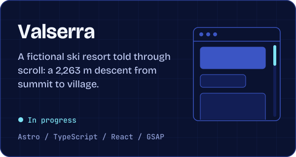
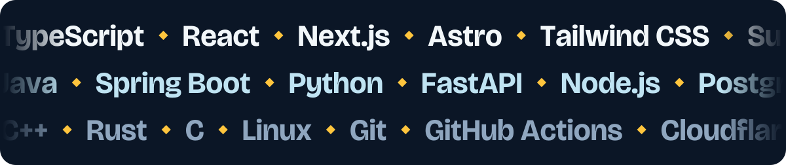

Soy Adri. Estudio Ingeniería Informática del Software en la Universidad de Oviedo y, mientras tanto, construyo cosas que se puedan usar: desde el diseño en Figma hasta el despliegue. Me gusta cuidar la arquitectura, la accesibilidad y el detalle.

## En qué ando

  
  

  
  

También por aquí: [yovi_en2c](https://github.com/Arquisoft/yovi_en2c), un juego de estrategia hecho en equipo con React, Rust y Node.js; [Farmland](https://github.com/Adrigarsu/farmland), un juego de granja en Godot; [pokemon](https://github.com/Adrigarsu/pokemon), un sistema de combate en Java; y [LearnCpp](https://github.com/Adrigarsu/LearnCpp), mis proyectos siguiendo *A Tour of C++*.

## Con qué trabajo

## Hablamos

Escríbeme a [adrigarsu269@gmail.com](mailto:adrigarsu269@gmail.com) o pásate por [hoemapp.com](https://hoemapp.com) y [Valserra](https://adrigarsu.github.io/valserra/) para ver lo último en lo que trabajo.
