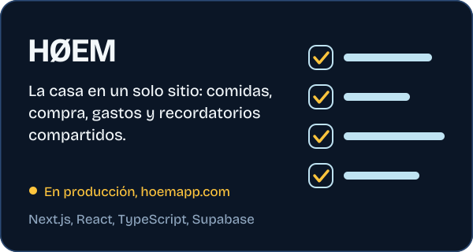
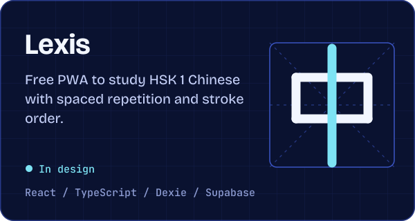

I'm Adri, a software engineering student at the University of Oviedo. I build web products end to end, from the Figma file to the deploy, and I care about architecture, accessibility and detail.

## Recent work

  
  

  
  

Also here: [PingAtlas](https://github.com/Adrigarsu/Ping-Atlas), a self-hosted latency map built on pings and traceroutes; [Farmland](https://github.com/Adrigarsu/farmland), a farming game made with Godot; [pokemon](https://github.com/Adrigarsu/pokemon), a combat system in Java; and [LearnCpp](https://github.com/Adrigarsu/LearnCpp), my projects following *A Tour of C++*.

## Stack

## Contact

Write to me at [adrigarsu269@gmail.com](mailto:adrigarsu269@gmail.com), or visit [hoemapp.com](https://hoemapp.com) and [Valserra](https://adrigarsu.github.io/valserra/) to see what I'm working on.
